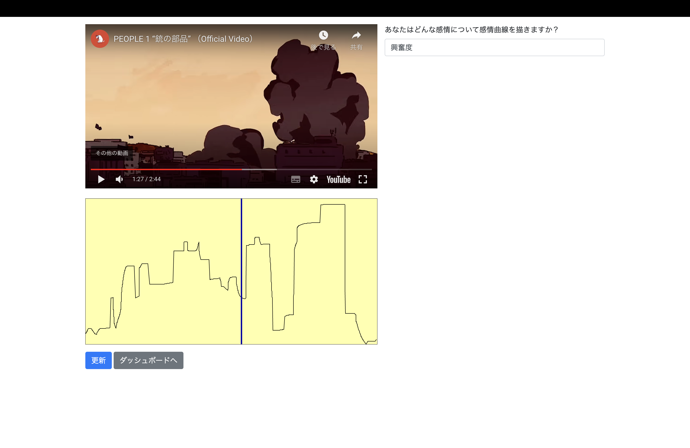

# Backend of Emonotate: Draw and Collect Emotional Arc

Emonotate brings to draw and collect emotional arcs. 
This is a backend project for Emonotate.
You need to clone [frontend project for Emonotate](https://github.com/tomoya-kwansei/emonotate-app) if you use.




# Current Features

- [x] Account Management
- [x] 

# Development Overview

## Overall Architecture 
This is a project for Emonotate: support to draw and collect emotional arcs with React.js.

## Setup

Make sure to have the following pre-requisites installed:
1. node 16.x
2. npm 9.4.0
3. Android 8.0+ Phone or Emulation setup

Fork and clone this repository and import into Android Studio
```bash
git clone https://github.com/tomoya-kwansei/emonotate-app/
```

You need to set **lots** of  enviroment variables below:
* AWS_ACCESS_KEY_ID
* AWS_BUCKET_URL
* AWS_SECRET_ACCESS_KEY
* AWS_STORAGE_BUCKET_NAME
* BUCKETEER_AWS_ACCESS_KEY_ID
* BUCKETEER_AWS_REGION
* BUCKETEER_AWS_SECRET_ACCESS_KEY
* BUCKETEER_BUCKET_NAME
* DEBUG_EMAIL_BACKEND
* DISABLE_COLLECTSTATIC
* DJANGO_SECRET_KEY
* EMAIL_BACKEND
* EMAIL_HOST
* EMAIL_HOST_PASSWORD
* EMAIL_HOST_USER
* EMAIL_PORT
* GCP_STORAGE_REFRESH_TOKEN
* GCP_STORAGE_TOKEN
* HEROKU_POSTGRESQL_COBALT_URL
* MAILGUN_API_BASE_URL
* MAILGUN_API_KEY
* MAILGUN_DOMAIN
* MAILGUN_PUBLIC_KEY
* MAILGUN_SENDER_NAME
* MAILGUN_SMTP_LOGIN
* MAILGUN_SMTP_PASSWORD
* MAILGUN_SMTP_PORT
* MAILGUN_SMTP_SERVER
* QUESTIONAIR_URL
* RANDOM_USERNAME_NUM="16"
* REDIS_TLS_URL
* REDIS_URL
* STAGE
* YOUTUBE_API_KEY
* DATABASE_URL
* GS_BUCKET_NAME
* SECRET_KEY

I will remove these unnecessary environment variables. 

Please wait.

## Starting Developlment Server
> **Warning**
>
> You need to clone [Frontend for Emonotate](https://github.com/tomoya-kwansei/emonotate-app) before you use.

## Building
Build the app:
```bash
npm run build
```

## Testing
Run `make test` (Cognito and media tests with `backend.settings.test_cloud`).

## How to Deploy
Pushing to `develop` deploys to dev and pushing to `main` deploys to production on AWS, through GitHub Actions.

The production branch is `main`, initialized from the former `master`. Before the first production merge, apply the parent repository's production Terraform change granting this branch the deploy role. Merge a release PR from `develop` to `main`. After deployment and production verification succeed, Actions publishes `release-pr-<PR number>` at the merged commit. If verification fails, rerun the failed jobs after resolving the cause.

## Development Workflow

Same rules as the parent repository [tombee-studio/emonotate](https://github.com/tombee-studio/emonotate).

1. Run `make setup` once after cloning to enable `.githooks` (`commit-msg`, `pre-push`).
2. Branch from `develop`: `<kind>/#<task_id>_<short_description>` (`feature` / `bugfix` / `hotfix` / `enhancement`).
3. Commit messages (checked by `commit-msg`, ASCII only):

   ```
   <Ftr|Fix|Eta>: <Summary starting with uppercase> #<task_id>

   - Detail line (50 chars max)

   Task: <task_id>
   ```

4. Open a PR to `develop` linked to an issue (`Closes #<issue>` or the Development sidebar).
   `Test` and `Linked issue` must pass.

`pre-push` needs `TOOL_API_URL`, `TOOL_API_KEY` and `TOOL_USER_ID` in the environment (for example via `direnv`).

## GitHub Actions

| Workflow | Trigger | Behavior |
|---|---|---|
| `test` | PR to `develop`/`main`, called by deploys | `check`, migration check, `migrate` on TLS PostgreSQL, Cognito/media tests |
| `require-linked-issue` | PR to `develop`/`main` | Fails unless the PR or its branch is linked to an issue |
| `deploy-dev` / `deploy-prd` | push to `develop` / `main` | test → ECR image → Lambda → `migrate --fake-initial` → Cognito redirect check via CloudFront |
| `update-task-status-on-merge` | push to `develop` | Marks each commit's `Task:` as merged in the task tool |

Secrets: `AWS_CI_ROLE_ARN_DEV`, `AWS_CI_ROLE_ARN_PRD` (`ci_role_arn` from the parent's Terraform), `TOOL_API_KEY`, `TOOL_TASK_API_URL`, `TASK_STATUS_MERGE_ID`.
Mark `Django test` and `Linked issue` as required status checks for `develop` and `main`.

After a deploy, update this submodule's commit in the parent repository so its integration tests cover it.

# Contributing

[Issues](https://github.com/tomoya-kwansei/emonotate-backend/issues) and [pull requests](https://github.com/tomoya-kwansei/emonotate-backend/pulls) are very welcome.

# MIT License

Copyright (c) 2023 Vitor Pamplona

Permission is hereby granted, free of charge, to any person obtaining a copy
of this software and associated documentation files (the "Software"), to deal
in the Software without restriction, including without limitation the rights
to use, copy, modify, merge, publish, distribute, sublicense, and/or sell
copies of the Software, and to permit persons to whom the Software is
furnished to do so, subject to the following conditions:

The above copyright notice and this permission notice shall be included in all
copies or substantial portions of the Software.

THE SOFTWARE IS PROVIDED "AS IS", WITHOUT WARRANTY OF ANY KIND, EXPRESS OR
IMPLIED, INCLUDING BUT NOT LIMITED TO THE WARRANTIES OF MERCHANTABILITY,
FITNESS FOR A PARTICULAR PURPOSE AND NONINFRINGEMENT. IN NO EVENT SHALL THE
AUTHORS OR COPYRIGHT HOLDERS BE LIABLE FOR ANY CLAIM, DAMAGES OR OTHER
LIABILITY, WHETHER IN AN ACTION OF CONTRACT, TORT OR OTHERWISE, ARISING FROM,
OUT OF OR IN CONNECTION WITH THE SOFTWARE OR THE USE OR OTHER DEALINGS IN THE
SOFTWARE.
